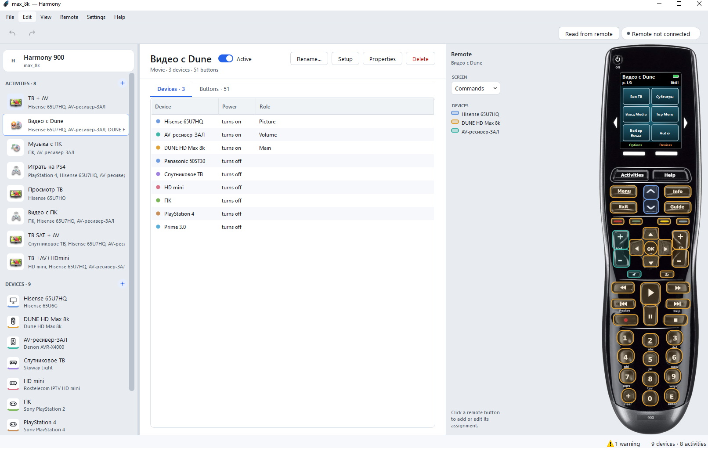
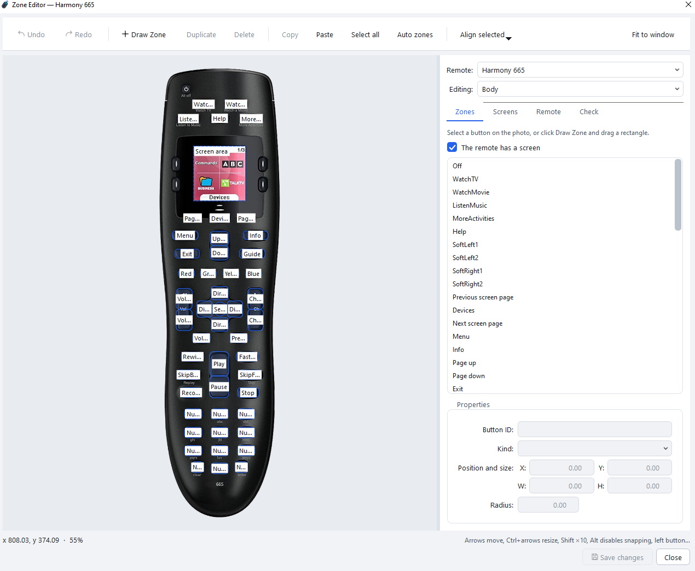

# Harmony — Logitech Harmony remote configuration editor

**English** · [Русский](README.ru.md)

[](https://github.com/don10077/Remote/actions/workflows/ci.yml)
[](https://github.com/don10077/Remote/releases)

Configure your **Logitech Harmony** remote on your computer. Edit devices, activities,
physical buttons and screen commands, learn infrared signals, and keep local backups
without using Logitech's configuration software or cloud service.

Harmony is a free, open-source desktop application for **Windows, Linux and macOS**.
Reading and writing configurations have been tested on a real **Harmony 900 under Windows**.
Support for other models is experimental and varies by model.

[Website](https://don10077.github.io/Remote/) ·
[Download Harmony](https://github.com/don10077/Remote/releases) ·
[Get started](#get-started-with-harmony-900) ·
[Remote support](#remote-support) ·
[Report a problem](https://github.com/don10077/Remote/issues)



## Features

- Edit devices, activities, physical and screen buttons, macros, delays and properties.
- Add devices from the Logitech IR code database, identify a device using its original
  remote, learn IR commands or enter codes manually.
- Review configuration checks and changes before writing, with automatic backups,
  configuration history, undo and redo.
- Open and save `.EZHex` configuration files, including files from Concordance and Afterglow.
- Capture a remote into one `*.remote.json` file containing the original configuration,
  model and firmware details, timestamp, program version and SHA-256.
- Define remote photos, button zones and screen layouts with the built-in zone editor.
- Use the graphical editor or the bundled `harmony-cli`. English and Russian are included.

## Remote support

| Remote or feature | Current status |
|---|---|
| Harmony 900 | Configuration reading, editing and writing tested on hardware under Windows |
| Harmony One, 600, 650, 665 and 700 | Experimental USB configuration capture. Captured configurations need format-specific editor support |
| Other Harmony models | Transfer capabilities vary. Run `harmony-cli models` for the catalog |
| Harmony Hub | Experimental network configuration reading |
| Visual remote profiles | Photos, button zones and screen layouts can be edited independently of configuration transfer support |

Harmony 665 capture is awaiting a hardware test by its owner. Changing the target model
or adding its photo and button zones requires the corresponding configuration format
and transport support before a configuration can be written to that model.

Keep a backup before writing. Harmony is an unofficial project, distributed under
GPL-3.0-only without warranty. Writing changes the remote's configuration memory.

## Get started with Harmony 900

1. Download and install the package for your operating system from Releases.
2. Connect the remote by USB. On Windows, install the USB network driver supplied with
   Logitech Harmony Remote Software 7.8, then close Logitech's application.
3. In Harmony, read the remote and save a backup as `.EZHex`.
4. Edit your devices, activities and button assignments.
5. Review configuration checks and the proposed changes before writing to the remote.

Harmony 900 uses a USB network connection. The remote normally listens at
`169.254.1.2`, TCP port `3074`. Connection settings are available in the application.

Harmony 1100 uses the same USB network connection. On Windows, open Network
Connections (`ncpa.cpl`) and check that **RemoteControl USBLAN Adapter** is enabled.
If it is disabled, enable it with administrator permission, then reconnect the remote
and wait for the adapter to obtain an IP address before reading. A disabled adapter
prevents both detection and configuration reading, even when the USB driver is installed.

The connection indicator distinguishes a missing USB device, missing driver, disabled
adapter, missing IP address and a remote that does not answer. Hover over it or open
**How to connect the remote… → Show Details** for diagnostics. **Recover USB connection…**
enables or restarts only the connected Harmony USB network adapter, requests Windows
administrator permission and checks the connection again. State changes are recorded
in the program journal. Initial connection checks retry while the adapter becomes ready.

Harmony checks GitHub releases at startup and offers newer versions. This can be disabled
in Settings; **Help → Check for updates…** checks manually. An installed Windows copy
downloads the installer, verifies its size and SHA-256, then asks Windows to start it.
Unsaved changes are checked before Harmony closes, and the installer waits for it to exit.
Portable copies and other operating systems open the release page instead. The driver
is not bundled with program updates.

On Linux, use **Set up USB connection…** in the connection menu for the initial setup.
The application installs the required USB network and HID access rules with administrator
permission. Reconnect the remote afterwards. The USB network setup requires `dnsmasq`,
`ip`, systemd and udev. Allow incoming UDP port 67 on that interface if a firewall is enabled.

## Download and run

| System | Package | Run |
|---|---|---|
| Windows 10/11 x64 | `Harmony-<version>-setup.exe` | Run the installer |
| Windows portable | `Harmony-<version>-windows-portable.zip` | Extract the entire archive and run `harmony.exe` |
| Linux x86_64, glibc 2.39+ | `Harmony-<version>-x86_64.AppImage` | Make it executable with `chmod +x` and run it |
| macOS, Apple Silicon and Intel | `Harmony-<version>-macos.dmg` | Open the image and drag Harmony to Applications |

Download packages and `SHA256SUMS.txt` from the same release. On Windows, use
`certutil -hashfile <file> SHA256` to check a package against the published checksum.

The Windows application is unsigned and macOS builds use an ad-hoc signature. Windows
SmartScreen or macOS Gatekeeper may ask you to approve the application on first launch.
On macOS, use the option to open it in **System Settings → Privacy & Security** if needed.
Remote communication on Linux and macOS still needs hardware testing.

Settings, configuration history and backups are stored separately from the application.

## Help add support for your remote

If you can, read the configuration from your Harmony remote and email the capture to
[don10077@mail.ru](mailto:don10077@mail.ru). Include the **remote model in the subject**,
for example `Harmony 665 configuration`, and attach the `*.remote.json` file.
Captures help us investigate formats and extend model support.

1. Close Logitech's software and connect one Harmony remote by USB.
2. Open **Remote → Configuration files — all models…**.
3. Select your model and choose **Read configuration to file…**.
4. Save the suggested `*.remote.json` file.
5. Email the saved file with your remote model. If reading fails, include the error
   text, program version and any file that was saved.

The capture contains your remote's configuration and device information. Review it
before sharing it publicly. For this capture procedure, use the read operation.

Command-line equivalent with automatic model detection follows.

```sh
harmony-cli transfer-read auto backup.remote.json
```

## Remote zone editor

Add or refine a model's visual profile by placing clickable button zones on its photo,
assigning button identifiers and defining the screen area and layouts. The editor
includes automatic zone detection, alignment tools and undo/redo.



Visual profiles are stored in `app/resources/remotes/<id>/profile.json` with a `photo.png`.
Configuration parsing and USB communication need their own model support.
See the [resource guide](app/resources/README.md) and [profile schema](app/resources/remotes/SCHEMA.md).

## Command-line tools

The packages include `harmony-cli` beside the Windows application, inside
`Harmony.app/Contents/MacOS` on macOS, or in `usr/bin` after extracting the AppImage
with `--appimage-extract`.

```sh
harmony-cli models
harmony-cli info configuration.EZHex
harmony-cli check configuration.EZHex
harmony-cli diff before.EZHex after.EZHex
harmony-cli commands configuration.EZHex
harmony-cli transfer-info auto
harmony-cli transfer-read auto backup.remote.json
```

Run the utility without arguments for all commands, including IR learning, device
identification, database tools and remote operations.

## Build from source

The project uses C++23, CMake 3.28+, Ninja and Qt 6.5+. Use GCC 13+ or Clang 19+
with a standard library that supports `std::expected`. Dependencies also include
GoogleTest, pugixml, libzip and pkg-config. libconcord is bundled.

### Windows (MSYS2 UCRT64)

Install [MSYS2](https://www.msys2.org/) and run `build.cmd`. It installs missing packages,
builds Release, runs tests and deploys the application and DLLs to `dist/win`.
Use `build.cmd installer` to also create the Windows installer.

Before compiling, `build.cmd` checks Linux/macOS Qt packages using the shared
`.github/qt-packages.json` configuration. Python 3 and internet access are required.
Run `python tools/checkCiQt.py` separately to download only package metadata and
check the version, architectures and archives. Missing packages or unreachable
servers fail the check. It also requires bundled ICU when provided by Linux Qt.
CI runs `moc`, `uic` and `rcc` immediately after installation to detect missing
shared libraries. Native Linux/macOS builds and tests are still required.

`build.cmd` also builds all targets with Clang and warnings as errors in
`build/ucrt64/win-clang`, installing Clang through MSYS2 when needed. The first
build takes longer; subsequent builds are incremental. This catches Clang
warnings GCC may miss; Apple SDK and Apple Clang differences still require macOS CI.
Both local compilers target Windows and use UCRT headers. They cannot reproduce
Linux glibc diagnostics or every warning from the GCC 13 used on Ubuntu 24.04.
For Linux parity, also build and test the `core-only` and `release` presets on
Ubuntu 24.04 (natively, in WSL, or in a container) with its GCC 13 toolchain.

Windows builds use MSYS2 UCRT64, both locally and in GitHub Actions. Local build files are kept in `build/ucrt64/<preset>/` to separate them from previous MinGW64 builds.

The script looks for MSYS2 in `D:\Install\MSYS2` by default. Set `MSYS2_ROOT` for another location.

### Linux and macOS

Install the build dependencies and Qt, then configure with the appropriate Qt prefix.

```sh
cmake --preset release -DCMAKE_PREFIX_PATH=/path/to/Qt
cmake --build --preset release
ctest --preset release
```

The `core-only` preset builds the core, CLI and tests without the graphical application.
Linux packaging uses `tools/make-appimage.sh`. macOS packaging uses `tools/make-macos.sh`
and `macdeployqt`. For a universal macOS build, configure with
`-DCMAKE_OSX_ARCHITECTURES="arm64;x86_64"` and a universal Qt installation.

CI builds and tests Linux, Windows and macOS packages. Release tags must match the version
in `CMakeLists.txt`. Further platform setup and CLI details are in the
[Russian documentation](README.ru.md#сборка).

## Contributing and feedback

Hardware test reports, configuration format research, remote photos and button zones,
translations and reproducible bug reports all help extend model support.
When reporting a problem, include your remote model, operating system, steps to reproduce,
and the text from **Help → Program journal…**. **Copy version info** in About adds version details.

To add a language, place a Qt Linguist `harmony_<code>.ts` file in the application's
`translations` folder or `Documents/Harmony/translations`. Select it in Settings.
Update the built-in translation templates with `python tools/updateTranslations.py`.

## Acknowledgements

Harmony builds on code, format research and data shared by the Harmony community.
Thanks to the authors and contributors of these projects.

- [Afterglow](https://github.com/harmonic-afterglow/afterglow) — IR protocol and configuration format research.
- [Concordance / libconcord](https://github.com/jaymzh/concordance) — USB configuration transfer.
- [Logitech Harmony IR Archive](https://github.com/pickysysadmin/logitech-harmony-ir-archive) — preserved IR device data.
- [harmony-hub-root](https://github.com/Ripthulhu/harmony-hub-root) — help with Harmony Hub.

## License and support

Licensed under [GNU GPL v3](LICENSE) (GPL-3.0-only). Third-party components and datasets
retain their own licenses. Logitech and Harmony are trademarks of Logitech.

[Report an issue](https://github.com/don10077/Remote/issues) ·
[Support development on DonationAlerts](https://www.donationalerts.com/r/alexshkurko)
